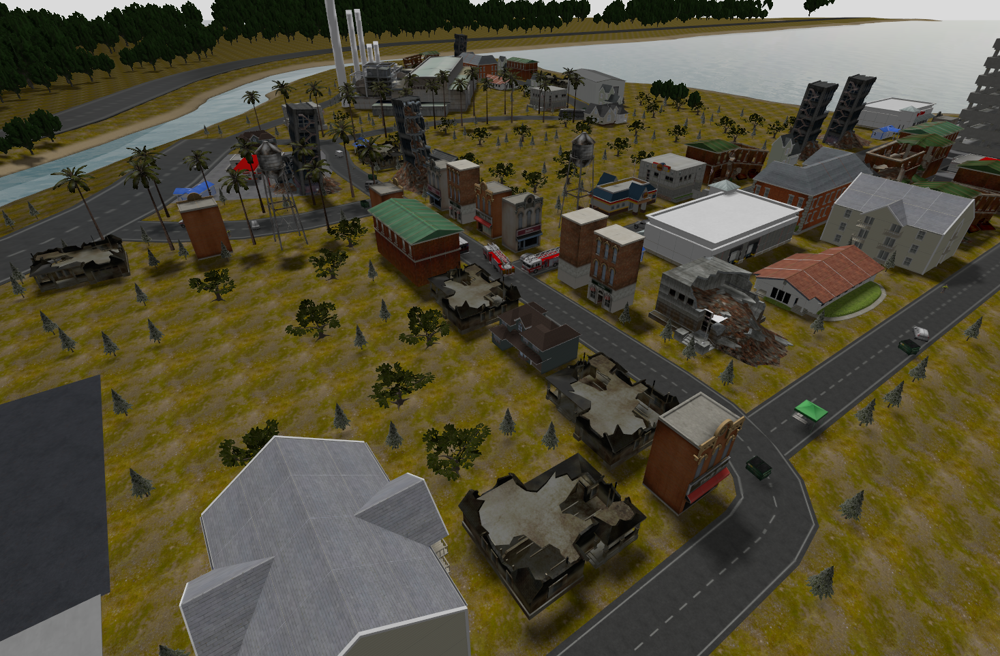
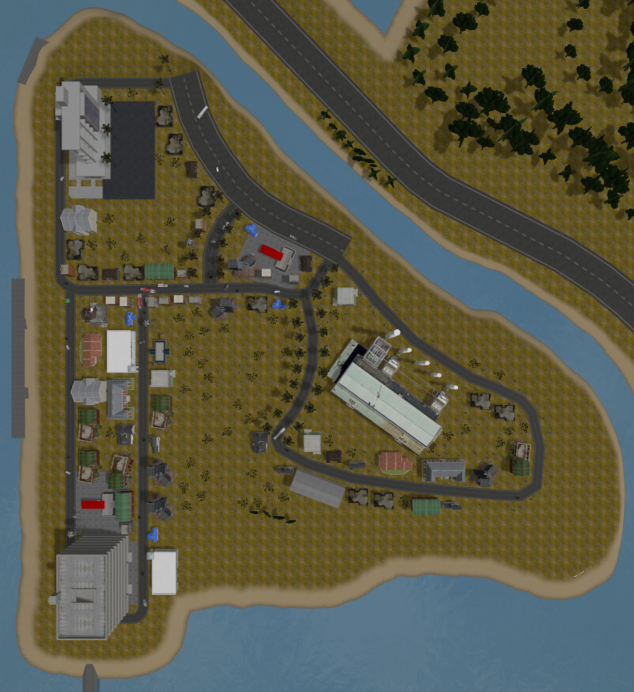

# disaster_world

ROS 2 package with Gazebo simulation worlds for search and rescue scenarios after a disaster. The worlds combine large outdoor environments from [Gazebo Fuel](https://app.gazebosim.org/fuel) with collapsed buildings, vehicles and victims, ready to test robot fleets (aerial, ground or surface) in disaster response missions.



## Key Features

- **Two disaster worlds**: Baylands Park (Sunnyvale, CA) and Nathan Benderson Park (Sarasota, FL).
- **Model library**: 44 ready-to-use models (buildings, collapsed buildings, vehicles, victims, vegetation, water and ground) that can be included in any world with `model://<name>`.
- **Victims ground truth**: the victim poses of each world are stored in a YAML file, so they can be used to evaluate detection and localization.
- **Geo-referenced**: each world defines its real latitude and longitude, so GPS (NavSat) sensors give real coordinates.

## Requirements

- ROS 2 Jazzy
- Gazebo Harmonic (gz-sim 8) with `ros_gz_sim`
- Internet connection the first time a world is launched, to download the Fuel models. They are cached in `~/.gz/fuel` afterwards.

## Installation

### Clone and Build

```bash
cd ~/ros2_ws/src
git clone https://github.com/juanscelyg/disaster_world
cd ~/ros2_ws
colcon build --symlink-install --packages-select disaster_world
source install/setup.bash
```

## Quick Start

Launch one of the worlds:

```bash
ros2 launch disaster_world disaster_baylands_world.launch.py
ros2 launch disaster_world disaster_nathan_benderson_park_world.launch.py
```

Any world file of the package can be launched with the generic launch file:

```bash
ros2 launch disaster_world disaster_world.launch.py world:=disaster_baylands_world.sdf
```

| Argument | Default | Description |
|---|---|---|
| `world` | `disaster_baylands_world.sdf` | World file inside `worlds/` (only in `disaster_world.launch.py`) |
| `gz_args` | `-r` | Extra arguments for `gz sim`, e.g. `-r -s` for headless |

The launch files add `share/disaster_world/models` to `GZ_SIM_RESOURCE_PATH`. If you run `gz sim` directly, add that folder yourself so `model://` URIs are found.

## Worlds

> Note: The worlds are not a faithful recreation of the real worlds, they are a fictional scenario for testing search and rescue missions.

### disaster_baylands_world

Based on the [Baylands](https://fuel.gazebosim.org/1.0/OpenRobotics/models/baylands) park. It contains victims spread over the park: Rescue Randy dummies and male and female survivors.

### disaster_nathan_benderson_park_world

Based on [Nathan Benderson Park](https://fuel.gazebosim.org/1.0/OpenRobotics/models/nathan_benderson_park), with animated water (`coast_water`) at z = 0. A small town is built along the park roads around x = -50, y = 900:

> **Init pose:** Suggested init pose for a robot: x = -120 y = 950

- Buildings, intact and collapsed, aligned with the roads (fire station, police station, school, houses, shops, offices, water tower, power plant...).
- Vehicles and dumpsters on the roads with random orientations, an ambulance and a ground station.
- 10 victims (`rescue_randy` and `rescue_randy_sitting`) on the roads, with random positions and orientations.
- 263 oak and pine trees on the grass of the island (none next to the parking garage nor on the gas station pavements), grouped in the single static model `island_trees` so they do not fill the entity tree.

The zenithal image below was taken from the gazebo camera at x = -120, y = 950, z = 50, looking down with pitch = -1.57 rad. 

```xml
<camera_pose>75 900 400 0 1.5708 0</camera_pose>
```



## Victims ground truth

The victim poses of each world are listed in `config/<world>_victims.yaml`, e.g. [config/disaster_nathan_benderson_park_world_victims.yaml](config/disaster_nathan_benderson_park_world_victims.yaml). Poses are in the world frame (meters and radians):

```yaml
world: disaster_nathan_benderson_park_world
count: 10
victims:
  - name: rescue_randy_2
    model: rescue_randy
    pose: {x: -119.25, y: 892.75, z: 4.58, yaw: 0.5039}
    near_building: apartment
    distance_to_building: 6.3
```

The file is installed in `share/disaster_world/config`, so a node can read it with `get_package_share_directory('disaster_world')`. After moving or adding victims in a world file, regenerate it from the package folder:

```bash
python3 scripts/generate_victims_yaml.py                                  # every world with victims
python3 scripts/generate_victims_yaml.py disaster_nathan_benderson_park_world.sdf
```

## Models ground truth

`scripts/generate_models_yaml.py` writes the pose of every model of a world into `config/<world>_models.yaml`. Trees and people are left out (the victims have their own file). Run it from the package folder after changing a world:

```bash
python3 scripts/generate_models_yaml.py                                   # every world in worlds/
python3 scripts/generate_models_yaml.py disaster_nathan_benderson_park_world.sdf
```

```yaml
world: disaster_nathan_benderson_park_world
count: 101
models:
  - name: osrf_first_office
    model: osrf_first_office
    pose: {x: -103, y: 910, z: 4.45, roll: 0, pitch: 0, yaw: -1.5708}
```

## Models

All the models are in `models/` and can be used in any world:

```xml
<include>
  <uri>model://ambulance</uri>
  <name>ambulance_1</name>
  <pose>10 5 0 0 0 0</pose>
</include>
```

| Category | Models |
|---|---|
| Buildings | `apartment`, `fast_food`, `fire_station`, `gas_station`, `grocery_store`, `house_1`, `house_2`, `house_3`, `law_office`, `osrf_first_office`, `parking_garage`, `police_station`, `post_office`, `power_plant`, `salon`, `school`, `thrift_shop`, `water_tower`, `playground` |
| Collapsed buildings | `collapsed_fire_station`, `collapsed_house`, `collapsed_industrial_building`, `collapsed_police_station` |
| Vehicles and street | `ambulance`, `bus`, `fire_truck`, `hatchback`, `hatchback_blue`, `hatchback_red`, `pickup`, `suv`, `truck_box`, `dumpster`, `ground_station` |
| Victims | `rescue_randy`, `rescue_randy_sitting`, `standing_person`, `survivor_female`, `survivor_male` |
| Vegetation | `oak_tree`, `pine_tree`, `nathan_benderson_island_trees` (all the trees of the Nathan Benderson Park island in one model) |
| Ground and water | `coast_water`, `pavement_plane` |

There are two kinds of models:

- **Wrappers**: a `model.sdf` that includes the original Fuel model. They are downloaded the first time they are used.
- **Local copies**: meshes and textures are stored in the package because the Fuel model needed a fix to work in Gazebo Harmonic:
  - Ogre 1 material scripts replaced by PBR materials (`gas_station`, `fast_food`, `dumpster`, `house_1`, `house_2`, `house_3`, `pavement_plane`).
  - Textures placed next to the meshes that reference them (`water_tower`, `police_station`, `collapsed_police_station`, `hatchback`, `hatchback_red`, `fire_truck`).
  - Made static so they stay where they are placed (`truck_box`, `dumpster`).
  - Line primitives removed from the mesh, which crash the physics engine (`power_plant`).
  - Shaders and textures used with relative paths (`coast_water`).

Some wrappers still log `Could not resolve file [...]` for their textures (e.g. `school`, `apartment`, `ambulance` and the collapsed buildings), because the Fuel meshes look for them in the wrong folder.

## Package structure

```bash
disaster_world/
├── config/      victims and models ground truth
├── docs/        images
├── launch/      launch files
├── models/      model library
├── scripts/     tools (models and victims ground truth generators)
└── worlds/      world files
```

## License

The package is licensed under the Apache License 2.0. The models come from [Gazebo Fuel (OpenRobotics)](https://app.gazebosim.org/OpenRobotics/fuel/models) and keep their own licenses, CC0 1.0 or CC BY 4.0. The license and the source of every local copy are in its `model.config`.
